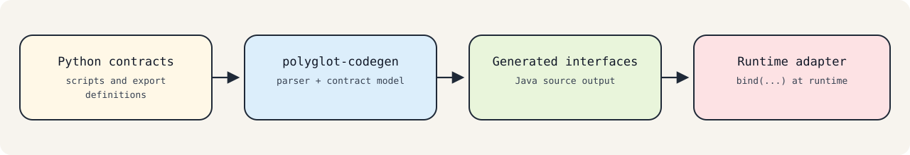

# Code Generation

## Overview

The code generation tooling complements the runtime adapter by turning supported guest-language contracts into Java source files.

It is build-time tooling, not runtime execution:

- it uses an isolated GraalPy Context for the official Python `ast` module
- it never evaluates or imports application Python source
- it does not depend on the adapter runtime implementation

> Note
> Code generation is optional. The runtime adapter can be used with handwritten Java interfaces or with generated ones.

## Modules

### `polyglot-codegen`

This module contains the generation pipeline:

- `ContractGenerator` and `DefaultContractGenerator`
- parser dispatch by `SupportedLanguage`
- Python contract parsing
- Java type rendering
- Java interface generation
- a CLI entry point

### `polyglot-codegen-maven-plugin`

This module integrates the generator with Maven. It:

- scans an input directory
- filters supported script files by extension
- invokes the generator
- writes Java output
- registers the generated sources directory with Maven

## How Code Generation Works

The implemented pipeline is:

1. walk the configured input directory
2. detect the language from the file extension
3. create a `ScriptDescriptor`
4. parse the source into a `ContractModel`
5. render one Java interface per discovered contract
6. write the result under the configured Java package

The generator is deterministic:

- imports are collected and sorted
- interface source is rendered from the shared model
- generated files include a checksum header based on the rendered interface body

## Parser Responsibilities

Language parsers convert source syntax into the adapter’s language-neutral contract model.

### Python Parser

`PythonContractParser` is the only fully implemented parser today. It:

- looks for `polyglot.export_value(...)`
- detects whether the export points to a class or a dictionary-style function map
- extracts method signatures
- respects `CodegenConfig.onlyIncludedMethods()`
- skips private methods by default
- maps Python type hints into `PolyType`

Python syntax is parsed by GraalPy `ast.parse`. Java code reads detached AST nodes and applies the existing contract conventions; it does not maintain a Python lexer or grammar. Syntax validity alone does not prove binding, conversion or runtime behavior.

#### Class-Style Exports

Generation reads `ClassDef` nodes with or without base classes:

```python
class ForecastService:          # no base class
class ForecastService(Protocol): # single base class
class ForecastService(BaseA, BaseB): # multiple base classes
class ForecastService (Base):   # space before parentheses
```

Generation retains the existing declared-method projection. Binding/compatibility checks classify unresolved inheritance and metaclasses as UNKNOWN.

#### Multiple Exports Per File

A single Python file may contain multiple `polyglot.export_value(...)` declarations. Each
declaration produces one `ContractClass` in the resulting `ContractModel`, and the Maven plugin
generates one Java interface file per class:

```python
polyglot.export_value("OrderService", OrderService)
polyglot.export_value("InventoryService", InventoryService)
```

Contracts are returned in source order (the order `polyglot.export_value(...)` lines appear in
the file).

#### Duplicate Export Names

If two or more `polyglot.export_value(...)` declarations in the same file use the same API name,
`parse(...)` fails immediately with an `IllegalStateException` that includes the duplicate name.
This check runs in all modes, not only in `strictMode`.

```python
# This will fail at parse time:
polyglot.export_value("Api", ClassA)
polyglot.export_value("Api", ClassB)  # duplicate name → IllegalStateException
```

Supported subset today:

- `polyglot.export_value(...)` with a class export or dictionary-style export
- multiple `polyglot.export_value(...)` declarations per file
- class definitions with optional base classes
- top-level Python functions used in exported dictionaries
- class methods and basic type hints aligned with the repository type model

Generated methods expose fixed positional parameters. Positional-only parameters and defaults are
supported; `*args`/`**kwargs` may receive an empty tail. Optional keyword-only parameters are omitted
so Python applies their defaults. Required keyword-only parameters fail generation with a
source-located error because the runtime supplies positional arguments only. Generation reuses the
calling metadata reader; nested declarations, strings and comments are not exported class members.
This remains a contract subset, not a runtime or behavioral validator.

Unannotated methods retain the existing inference rules. In particular, Sphinx `:return:` /
`:returns:` documentation keeps the released `Object` return type; use a Python return annotation
to refine it explicitly. Tuple annotations containing maps retain their existing `Object` element
projection. Unknown generic annotations remain unknown without interpreting their type arguments.
Standalone executable exports and dynamic export factories cannot define a generated Java interface;
generation rejects these targets instead of emitting an empty interface. They remain subject to the
separate binding/compatibility rules, including UNKNOWN for unresolved dynamic targets.

Not promised today:

- static contract support for every valid Python construct
- semantic import resolution
- runtime-equivalent understanding of arbitrary Python constructs
- JavaScript contract generation

### JavaScript Parser

`JsContractParser` exists as an extension point only. It currently throws `UnsupportedOperationException`, so JavaScript code generation is not supported in the current version.

## Type Mapping

The type model used by code generation is intentionally small:

- `PolyPrimitive`
- `PolyList`
- `PolyMap`
- `PolyObject`
- `PolyUnion`
- `PolyUnknown`

Current Java rendering behavior is conservative:

- primitives map to boxed Java types
- lists map to `List<T>`
- maps map to `Map<K, V>`
- unsupported or richer types fall back to `Object`

Python `set`/`Set[...]` annotations, including nested sets, fail generation explicitly. The previous
set-to-Java-List mapping cannot execute with standard GraalPy conversion; it is not silently changed
to `Object` or `Set`. Return a Python list/tuple or keep a handwritten Java contract with custom
conversion. Existing list/tuple generated return types remain unchanged. Compatibility analysis
continues to report set annotations as UNKNOWN. `validate-contracts` checks binding/arity, not
actual guest values or conversion safety.

## AST backend and lifecycle

Python analysis now requires the existing managed GraalPy version at build time. The only Python
source evaluated by the backend is the fixed `import ast` bootstrap. Application text is passed to
`ast.parse`; its imports, decorators, annotations, defaults and bodies are never evaluated. No
Python helper resource or serialized metadata protocol is used. Contract semantics and type mappings
remain in Java, and JavaParser still renders the same interfaces, packages and generated-source layout.

Each Maven generation/validation/compatibility execution owns one lazy Context and Engine for its
batch. Access and close are synchronized. The Context ignores application Python paths, site hooks
and environment settings, ignores JVM `polyglot.*` properties (including Maven goal options),
and has no host, native or application IO access. No process-wide parser
cache is used. Initialization failures fail the build with the original cause.

Programmatic callers can use `PythonContractParser.openBatch()` or
`DefaultContractGenerator.openBatch()` in try-with-resources. Released no-arg constructors and
entry points remain available; one-shot parsing closes its interpreter after each operation.
AST nodes and GraalPy types remain internal. Syntax errors retain file, line and column; AST
semantic columns use Python's UTF-8 byte offsets, while SyntaxError offsets retain Python's
character-column convention. UNKNOWN is never converted to COMPATIBLE because parsing succeeded.

Golden tests compare Java source byte-for-byte against the pre-migration P1-fixed generator,
including actual sample contracts, alias ordering, type rendering, decorators and inclusion rules.

Measured locally on macOS ARM64 with GraalPy 25.0.4.1.1 (Python 3.12.8), using interpreter
fallback on OpenJDK 21.0.2 and Oracle HotSpot 25, respectively:

| Measurement (median of three fresh JVMs) | Java 21 | Java 25 |
| --- | ---: | ---: |
| First parse, including Context initialization | 1.81 s | 1.39 s |
| Warm batch of 100 files | 130 ms | 189 ms |
| Warm throughput | 876 files/s | 833 files/s |
| Retained heap increase after GC | 47.7 MiB | 47.2 MiB |
| Whole-process peak RSS | 443 MiB | 428 MiB |

The workload reads 100 files copied cyclically from the eight golden/sample contracts and projects
their AST into ContractModel, without Java rendering. Each process uses one batch, one thread,
`-Xms64m -Xmx512m`, 300 warmup parses, then one measured batch and 1,000 throughput parses.
Heap is measured after GC with the Context still open; RSS includes the entire JVM. These are local
cost measurements, not a GraalVM distribution benchmark or a performance improvement claim.
Batch reuse amortizes initialization; the released one-shot entry points still initialize per call.

## Maven Plugin Usage

The Maven plugin goals are:

```text
polyglot:generate
polyglot:check
polyglot:doctor
polyglot:validate-contracts
polyglot:check-compatibility
```

Generation defaults:

- phase: `generate-sources`
- input directory: `${project.basedir}/src/main/resources`
- output directory: `${project.build.directory}/generated-sources/polyglot`
- base package fallback: `${project.groupId}.polyglot`

The plugin adds the output directory as a compile source root, so generated interfaces are compiled automatically in the same build.

Additional Maven plugin options:

- `onlyIncludedMethods` (default: `false`)  
  When enabled, only methods marked with `@adapter_include` are generated.
- `strictMode` (default: `false`)  
  Fails generation if unresolved/unknown types are detected in parsed contracts.
  This prevents silently propagating `Object`-like contracts into generated APIs.
- `failOnNoContracts` (default: `false`)  
  Fails the build if scanning finishes with zero generated contracts.
- `skipUnchanged` (default: `true`)  
  Skips rewriting generated files when rendered content is unchanged.
- `failOnContractDrift` (default: `false`)  
  In `polyglot:generate`, switches to drift-check behavior and fails when generated files differ.

DX workflow pattern:

- local update: `./mvnw polyglot:generate`
- CI verification: `./mvnw polyglot:check`
- local diagnostics alias: `./mvnw polyglot:doctor` (same behavior as `check`)

Recommended policy:

- use `strictMode=true` for contracts that are intended to become stable Java-facing APIs
- use `polyglot:check` in CI to detect drift without rewriting files
- treat `polyglot:doctor` as a local diagnostic convenience, not as a separate behavior contract

For parser limitations, drift failures, and common check/doctor symptoms, see
[`troubleshooting.md`](troubleshooting.md).

## Opt-In Java-to-Python Contract Validation

`polyglot:validate-contracts` checks explicitly selected Java interface sources against
Python sources through an isolated GraalPy AST Context, without importing or evaluating application modules.
It complements `check`/`doctor`, which compare generated text rather than existing Java bindings.
The goal is disabled by default, including when configured as an execution.

```xml
<plugin>
    <groupId>io.github.ih0r-d</groupId>
    <artifactId>polyglot-codegen-maven-plugin</artifactId>
    <version>0.5.0-SNAPSHOT</version>
    <configuration>
        <inputDirectory>${project.basedir}/src/main/resources/python</inputDirectory>
        <contracts>
            <contract>${project.basedir}/src/main/java/example/GreetingApi.java</contract>
        </contracts>
    </configuration>
    <executions>
        <execution>
            <id>validate-python-contracts</id>
            <goals><goal>validate-contracts</goal></goals>
        </execution>
    </executions>
</plugin>
```

Enable validation for this build:

```bash
./mvnw -Dpolyglot.codegen.validateContracts=true verify
```

Alternatively, set `<validateContracts>true</validateContracts>` in an opt-in Maven profile.
The goal's default phase is `verify`; it writes no files and registers no source roots.
`contracts` must contain at least one existing Java source when enabled, unless annotation
discovery below is enabled. Generated interfaces
can be selected by their generated-source paths after the `generate` execution has run.

For `interface GreetingApi { String hello(); }`, the expected source is
`inputDirectory/greeting_api.py`, following the runtime's naming convention:

```python
import polyglot

class GreetingApi:
    def hello(self):
        return "hello"

polyglot.export_value("GreetingApi", GreetingApi)
```

Success reports `Python contract validation passed: 1 Java source(s).` Removing `hello`
fails Maven with a diagnostic such as:

```text
GreetingApi.java:1: module 'greeting_api', symbol 'GreetingApi.hello': Missing Python method in .../greeting_api.py
```

A missing module reports the expected Python file and Java contract. Unsupported Python
constructs report a Python file/line and fail, rather than silently validating an uncertain binding.

Validation supports one top-level Java interface per selected source without inheritance.
An optional `@PolyglotClient` must explicitly select `SupportedLanguage.PYTHON`; AUTO and multiple
languages cannot be inferred from build-time sources. Plain interfaces selected through `contracts`
retain `DEFAULT`. `convention` may explicitly select `DEFAULT`, `BY_INTERFACE_EXPORT` or
`BY_METHOD_NAME`. No Spring scanning or application class loading is involved.

The validator reuses `PythonContractParser`, its existing signature metadata reader and
`ContractModel`. `PythonPositionalSignature` projects the shared metadata into a Java positional
arity range; the Maven plugin no longer maintains its own Python signature grammar. Generation and
`check-compatibility` retain their existing behavior, including their distinct expression policies.

### Binding conventions and positional arguments

For `DEFAULT`/`BY_INTERFACE_EXPORT`, select a literal class or dictionary export matching the Java
interface simple name. Plain instance methods exclude the first bound receiver, regardless of its
name or annotation. Dictionary-exported functions have no implicit receiver. The expected module
continues to be the runtime's snake-case interface name under `inputDirectory`.

For `BY_METHOD_NAME`, the same module naming applies, but a class/interface export is unnecessary:

```java
@PolyglotClient(languages = SupportedLanguage.PYTHON, convention = Convention.BY_METHOD_NAME)
interface GreetingApi {
    String hello(String name);
    String hello(String name, int count);
}
```

```python
def hello(name, /, count=1, *, suffix="!"):
    return (name + suffix) * count
```

Both overloads pass. A parameter named `self` in a top-level function still counts as an ordinary
Java-supplied argument. For supported literal `polyglot.export_value("hello", implementation)`
function aliases, executable polyglot exports take precedence over top-level language functions,
even if the same language function is declared later. Dictionary exports in the module do not hide
its top-level functions from `BY_METHOD_NAME` validation. Exporting a class as a callable requires
runtime constructor analysis and remains UNKNOWN.

Every Java overload is checked independently against the accepted positional range:

- Positional-only (`/`) and ordinary parameters both consume Java argument slots.
- Defaults make positional parameters optional; their values are never evaluated.
- `*args` gives an unbounded maximum (`*` in diagnostics).
- Optional keyword-only parameters do not consume positional slots.
- Required keyword-only parameters are incompatible: Java supplies no keyword arguments.
- `**kwargs` does not absorb extra positional arguments.
- Java arrays and Java varargs each supply one declared guest argument; they are not flattened.

Single/multiline signatures, trailing commas, comments, nested annotations and balanced string/container
or tuple defaults are supported for arity analysis. Escaped quoted defaults retain the existing
DEFAULT behavior. Default expressions are inspected for optionality, not evaluated for initialization
success or behavioral compatibility. Calls, lambda expressions and formatted strings in signatures remain UNKNOWN. Parenthesized annotations are interpreted through the official AST. Missing receivers, duplicate parameters, invalid ordering,
and unbalanced signatures produce UNKNOWN diagnostics rather than a successful check.

### Diagnostics and static limits

Both confirmed incompatibility and uncertainty fail enabled validation; there is no permissive
UNKNOWN option on `validate-contracts`. Messages retain Java contract/method locations and Python
module/declaration locations where available, with explicit classifications:

| Classification | Meaning |
| --- | --- |
| `INCOMPATIBLE: MISSING_MODULE` | The expected module is absent from the selected source root |
| `INCOMPATIBLE: MISSING_FUNCTION` | The supported source has no selected callable |
| `INCOMPATIBLE: POSITIONAL_ARITY` | A declared Java overload supplies an unsupported argument count |
| `INCOMPATIBLE: REQUIRED_KEYWORD` | Python requires keyword-only arguments Java cannot supply |
| `UNKNOWN: UNSUPPORTED_SYNTAX` | Static analysis cannot establish the binding/signature |
| `UNKNOWN: EXPORT_RESOLUTION` | A required literal DEFAULT export is absent; runtime fallback is not checked |

For example:

```text
GreetingApi.java:5: module 'greeting_api', symbol 'GreetingApi.hello': Java supplies 0 positional argument(s); Python accepts 1..2 (no implicit receiver), declared at .../greeting_api.py:2 [INCOMPATIBLE: POSITIONAL_ARITY]
```

The runtime also supports DEFAULT lookup in Python language bindings. A missing literal export
therefore does not, by itself, prove runtime failure: this validator reports UNKNOWN and preserves
its requirement for an explicit export. UNKNOWN messages recommend an explicit supported declaration
or runtime `validateBinding(...)`. Missing functions and unsupported syntax are never silently skipped.
The first failure follows source order; annotation discovery scans Java files in sorted order.

The supported semantic subset is plain local classes/functions, literal exports, static function
aliases, `polyglot` aliases and supported `typing` imports. Inheritance, decorators,
constructors/special methods, async/generator invocation, conditional declarations, dynamic/factory
exports, rebinding and nested declarations remain UNKNOWN for binding validation. Strings, tabs,
comments, escaped continuations and other syntax are interpreted by the official AST.

Official AST parsing validates Python syntax. Binding validation checks selected symbol existence and positional arity, not
annotation-to-Java type compatibility, actual return values, import availability, default-expression
success, constructor success or arbitrary Context binding collisions. Generation's `strictMode`
controls unknown generated types; it does not prove runtime conversion safety. Keep real runtime
binding/application tests for dynamic contracts. Runtime module evaluation, caching, reload, lifecycle,
metrics and tracing behavior are unchanged.

The `method-name-contracts` Maven Invoker fixture compiles real DEFAULT and BY_METHOD_NAME Java
interfaces and a consumer, then exercises valid defaults, export precedence, missing functions,
arity errors, required keywords and UNKNOWN syntax. It runs with the existing `plugin-it` profile.

### Annotation Discovery for Spring Boot Projects

Existing `@PolyglotClient` declarations can replace the manual `<contracts>` list. For example,
keep the application's existing contract:

```java
import io.github.ih0rd.polyglot.SupportedLanguage;
import io.github.ih0rd.polyglot.annotations.PolyglotClient;

@PolyglotClient(languages = SupportedLanguage.PYTHON)
public interface GreetingApi {
    String hello();
}
```

Configure the same plugin execution as above, but omit `<contracts>`. Then enable both flags:

```bash
./mvnw -Dpolyglot.codegen.validateContracts=true -Dpolyglot.codegen.discoverContracts=true verify
```

Alternatively, put `<validateContracts>true</validateContracts>` and
`<discoverContracts>true</discoverContracts>` in the plugin configuration of an opt-in Maven
profile. Before discovery, adding a client required another `<contract>` entry; with discovery,
adding its existing Java annotation is sufficient.

Discovery scans `.java` files recursively under `sourceDirectory` (default:
`${project.build.sourceDirectory}`, normally `src/main/java`) in sorted order. `inputDirectory`
continues to select the Python root. A nonempty explicit `<contracts>` list takes precedence,
even with discovery enabled, and retains its existing validation behavior. Discovery itself and
validation are both disabled by default; enabling discovery alone does not validate anything.
An enabled discovery run with no annotated contracts fails, so an incorrect source root cannot
silently pass as a successful validation.

The plugin identifies the exact framework-neutral `io.github.ih0rd.polyglot.annotations.PolyglotClient`
annotation through an explicit Java import or its fully qualified name. Unannotated interfaces
and explicitly imported foreign annotations with the same simple name are ignored. Wildcard-only
or locally shadowed annotation resolution fails as unsupported; use an explicit import or fully
qualified annotation instead. Java parsing does not require compiled application classes.

Discovered contracts go through the same module, export, method and positional-arity checks as
explicit contracts. They must explicitly select `SupportedLanguage.PYTHON` and may use
`DEFAULT`, `BY_INTERFACE_EXPORT` or `BY_METHOD_NAME`. AUTO/multiple-language selection, JS, inherited/nested interfaces
and other unsupported forms fail rather than being counted as successfully validated.

This is source discovery, not Spring bean discovery: no `ApplicationContext`, GraalVM `Context`,
application class loading or Python execution is involved. It does not interpret `@EnablePolyglotClients`,
Spring profiles, conditions, properties, or dependency JARs. Only the configured source root is
scanned; tests and additional generated-source roots are not implicitly included. Set
`sourceDirectory` to a narrower source directory when needed. All Python subset restrictions above
continue to apply.

The maintained Spring sample already uses explicit Python `@PolyglotClient` annotations, but its
Python implementations use imports, constructors and docstrings outside the current static subset.
This feature does not enable validation in that sample or change its runtime behavior. Spring
startup fail-fast remains the runtime check for such contracts; discovery does not widen the
Python parser's capabilities.

The packaged-plugin integration fixtures use the Apache Maven Invoker Plugin only in the
`plugin-it` profile, with an isolated repository and cloned fixtures:

```bash
./mvnw -B -ntp -Pplugin-it -pl build-tools/polyglot-codegen-maven-plugin -am verify
```

The fixtures use Maven's default settings discovery. To pass alternate settings explicitly, add
`-Dinvoker.settingsFile=/absolute/path/to/settings.xml`; the file must exist.

## Python Contract Compatibility

`check-compatibility` compares an explicitly selected baseline Python contract with current sources.
It checks whether existing **Java positional calls** and reliably mapped Java contract types are
preserved. It never imports or executes application Python and has no Spring or Git dependency. It uses the managed GraalPy dependency for AST parsing.
This complements `validate-contracts` (selected Java interfaces against current Python) and `check`
(generated-text drift). It does not prove full Python API or runtime behavioral compatibility.

```xml
<plugin>
    <groupId>io.github.ih0r-d</groupId>
    <artifactId>polyglot-codegen-maven-plugin</artifactId>
    <version>0.5.0-SNAPSHOT</version>
    <executions>
        <execution>
            <id>python-compatibility</id>
            <goals><goal>check-compatibility</goal></goals>
            <configuration>
                <baseline>${project.basedir}/contracts/baseline</baseline>
                <currentDirectory>${project.basedir}/src/main/resources/python</currentDirectory>
                <failOnUnknown>true</failOnUnknown>
            </configuration>
        </execution>
    </executions>
</plugin>
```

The goal runs in `verify` when configured as an execution; existing builds do not acquire an execution
automatically. Run `./mvnw verify` in CI with the committed baseline available. Direct invocation:

```bash
./mvnw polyglot:check-compatibility \
  -Dpolyglot.codegen.baseline=contracts/baseline \
  -Dpolyglot.codegen.currentDirectory=src/main/resources/python
```

`baseline` is required and has no default: select a reviewed snapshot from the released Java-facing
contract. The checker never chooses HEAD, checks out revisions, resolves artifacts or accesses the
network. A directory selects `.py` files recursively and matches their relative paths, including
nested modules. A `.py` baseline file selects only its basename under `currentDirectory`.
`currentDirectory` defaults to `${project.basedir}/src/main/resources/python` and must exist.
Missing/empty baselines and baselines containing no Java-facing functions fail configuration.
Missing current counterparts are BREAKING. Additional modules and functions are allowed, but
unsupported syntax in the selected current sources is still reported.

### Outcomes and Java calling rules

| Outcome | Meaning and build policy |
| --- | --- |
| `COMPATIBLE` | No break or uncertainty found within the supported static rules |
| `BREAKING` | A baseline callable/module disappeared, a Java call is no longer accepted, argument slots changed, or reliably mapped Java types differ; always fails |
| `UNKNOWN` | Unsupported syntax or insufficient static evidence; fails by default |

Set `-Dpolyglot.codegen.failOnUnknown=false` to report UNKNOWN as warnings without failing for
uncertainty. This never converts UNKNOWN into COMPATIBLE and never suppresses a BREAKING failure.
A report containing both has aggregate outcome BREAKING and retains all findings. Diagnostics are
sorted by file, line, symbol, category and explanation. Removed symbols point to the baseline;
other changes point to the current declaration. For example:

```text
greeting_api.py:2: BREAKING [POSITIONAL_ARITY] GreetingApi.hello: Java positional range narrowed from 1..1 to 2..2. **kwargs does not accept positional arguments.
```

The checker uses the same official AST and Java semantic metadata as generation, with separate calling
metadata. Neither the released `ContractModel` nor generated Java signatures change.
For modules with literal exports it compares those exported members, excluding implementation
helpers. Without exports it compares public top-level functions for `BY_METHOD_NAME` use.
Select roots containing the intended contracts rather than arbitrary application Python files.
Class-export receivers are implicitly bound and excluded regardless of their name. Dictionary
exports retain their function's full signature. Aliases are compared by exported Java member name.

Supported rules:

- Function removal/rename and module removal are BREAKING. Function additions are compatible.
- Every baseline accepted positional arity must remain accepted. New required positional parameters,
  removing defaults that raise the minimum arity, removing positional slots, and removing `*args`
  that lowers the maximum arity are BREAKING. Trailing optional parameters, relaxed requirements
  and adding `*args` can be compatible.
- `/` and ordinary parameters both accept Java's positional arguments. Changing between those two
  conventions is compatible. Moving a positional parameter to keyword-only can narrow accepted
  arities. New required keyword-only parameters are BREAKING because Java supplies no keywords.
  A baseline already requiring keywords is UNKNOWN, since it was not a supported Java binding.
- Optional keyword-only parameters and `**kwargs` do not add positional slots. Adding/removing
  `**kwargs` alone is compatible. This is not a guarantee for Python keyword callers.
- Moving a retained named parameter to another positional slot is BREAKING. A rename at the same
  slot is allowed. When a previously explicit parameter becomes captured by `*args`, value routing
  is UNKNOWN even when the argument count remains accepted.
- Changed defaults for retained positional/keyword-only parameters are UNKNOWN; the tool does not
  infer business semantics. Removing a positional default can independently be BREAKING by arity.
  Unchanged scalar literals (`None`, booleans, simple numbers and strings) are supported. Richer
  default expressions, including containers and calls, are UNKNOWN and never evaluated.
- Type comparison reuses `PythonTypeMapper`. Fully known `int`, `float`, `str`, `bool`, nested
  `list[T]`/`List[T]`, and `dict[K,V]`/`Dict[K,V]` are compared invariantly for positional arguments,
  `*args` and return values. Equal mappings are compatible; different mappings are BREAKING for
  the generated Java contract. These are not claims that Python enforces annotations at runtime.
  Adding/removing annotations is UNKNOWN. Missing annotations on both sides leave only structural
  checks. `Any`, unions, nullable `Optional`, forward references, aliases, sets, tuples and unknown
  generic leaves are UNKNOWN, even when unchanged; lossy mappings do not establish compatibility.

### Syntax and static limitations

The supported subset is plain module functions, plain local classes with instance methods, literal
class/dictionary exports after their targets, balanced single/multiline signatures, comments,
positional-only/keyword-only markers, defaults, `*args` and `**kwargs`. The AST reader resolves literal exports and function aliases. Dynamic imports, decorators, async/generator invocation and rebinding remain UNKNOWN.
Types outside the reliable subset still produce UNKNOWN. Underscore-prefixed functions are excluded.

Decorators, async/generator functions, inheritance, special methods (including constructors),
conditional declarations, arbitrary module imports/statements, rebinding and dynamic exports remain
UNKNOWN. Malformed syntax is reported by the official parser with file/line/column diagnostics;
duplicate definitions/parameters/exports remain semantic diagnostics. Opaque modules are not compared
for removals. Other modules are still checked. Escaped strings, multiline strings and modern body
syntax are parsed without executing them.

Function bodies are outside the comparison. This is not a full Python syntax/type checker: imports,
constructor execution, host conversion values, exceptions, side effects, return values, default
evaluation, global mutations and runtime body behavior are not validated. Body-only changes can
remain COMPATIBLE under this structural definition. Keep runtime binding checks and application
tests. Python calling conventions follow the official
[function definition rules](https://docs.python.org/3/reference/compound_stmts.html#function-definitions).

The [Maven consumer example](https://github.com/ih0r-d/polyglot-platform/tree/main/samples/java-maven-codegen-example)
contains passing evolution, removed function, newly required argument and explicit UNKNOWN scenarios.
Packaged-goal success/failure is also exercised by the `plugin-it` Invoker profile above.

Programmatic build integrations can use `new PythonCompatibilityChecker().compare(baseline,
currentDirectory)` from `io.github.ih0rd.codegen.compatibility`, returning an immutable
`CompatibilityReport`. `CompatibilityDiagnostic` exposes file, line, symbol, outcome, category and
explanation, plus `format()` for build logs. Parser metadata is internal and is not an extension SPI.

## Relationship to Runtime Execution

The code generation layer and the runtime adapter are separate by design, but they are intended to be used together.

Generated interfaces can be bound at runtime through:

- `PyExecutor`
- `JsExecutor`
- the Spring Boot starter

That is why the build tools follow the same naming conventions and contract model expected by the runtime adapter.

### Generated Interfaces and Spring Binding

Generated Java interfaces are plain interfaces with no framework annotations. To use a generated
interface with the Spring Boot starter, you must annotate it with `@PolyglotClient` and enable
client scanning:

```java
@PolyglotClient(languages = {SupportedLanguage.PYTHON})
public interface ForecastService {
    // generated methods
}
```

```java
@EnablePolyglotClients
@SpringBootApplication
public class MyApplication { ... }
```

The code generator does not add `@PolyglotClient` automatically. That annotation must be present
on the interface (either hand-written or added after generation) before the Spring starter can
register the corresponding bean.


