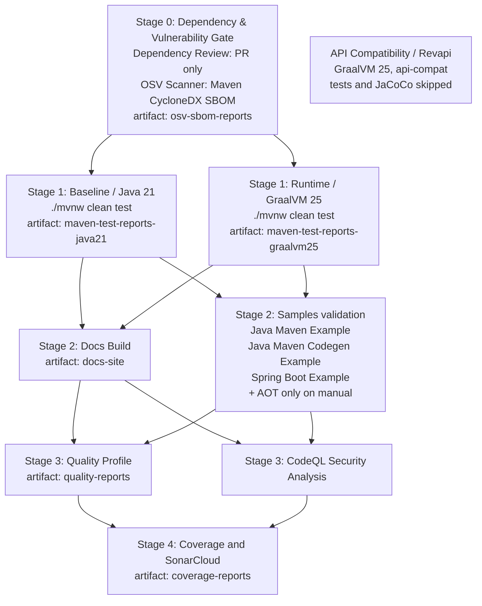

# Developer Tooling

This repository exposes one public Task interface:

- root `Taskfile.yaml`

Implementation details live under:

- `.dev/bin/*`: implementation scripts behind the public Task commands
- `.dev/lib/*`: shared shell helpers used by those scripts

Developer automation scripts require `bash`. Maven commands should be run through `./mvnw`.

## First-Time Setup

After cloning the repository, select the [pinned Oracle GraalVM](#pinned-oracle-graalvm)
through `JAVA_HOME` or SDKMAN, then run:

```bash
task dev:setup
```

`task dev:setup` enables repository-local Git hooks for the current clone, runs a lightweight
local validation step, does not publish artifacts, and does not require Maven Central or GPG
secrets. Hooks are not enabled automatically after clone.

To enable only the local hooks without running the full setup flow:

```bash
task dev:hooks
```

## Pinned Oracle GraalVM

SDKMAN is optional. To use an existing Oracle GraalVM `25.0.4.1.1` installation directly:

```bash
export JAVA_HOME=/absolute/path/to/graalvm/Contents/Home
export PATH="$JAVA_HOME/bin:$PATH"
task verify
task quality -- -Papi-compat
task samples
```

`Contents/Home` applies to macOS; use the extracted JDK root on Linux. Task scripts and
`benchmarks/run.sh` resolve Java in this order:

1. A nonempty `JAVA_HOME`, which must contain executable `bin/java` and `bin/javac`.
2. The already installed `.sdkmanrc` candidate under `${SDKMAN_DIR:-$HOME/.sdkman}`.
3. A JDK on `PATH`, following symbolic links, including Linux alternatives.

An invalid or incompatible explicit `JAVA_HOME` fails with a diagnostic; it is never replaced.
The selected JDK is placed first in the child process's `PATH` so Maven, plugins and forks agree.
The macOS `/usr/bin/java` launcher is not a JDK discovery fallback. If the SDKMAN candidate is
missing, an existing JDK on `PATH` can still be used. No SDKMAN initialization, automatic JDK
installation, network lookup or `sdk env` is performed by these scripts.

SDKMAN users can continue to run `sdk env` themselves. The optional local candidate is
`25.0.4.1.1-graal`; registering an existing JDK is only necessary when using that alias:

```bash
sdk install java 25.0.4.1.1-graal /absolute/path/to/graalvm/Contents/Home
sdk env
java -version
```

Verify both
`GRAALVM_VERSION="25.0.4.1.1"` and `JAVA_VERSION="25.0.4.1.1"` in the JDK `release` file.
For macOS AArch64, the exact archive is
[Oracle GDS GraalVM 25.0.4.1.1](https://gds.oracle.com/download/graal/25/archive/graalvm-jdk-25.0.4.1.1_macos-aarch64_bin.tar.gz),
with SHA-256 `e14dbe0dac6451c170c8b9403b04993bc8ae22e24f8b6c2a5b15e1803824e97c`.
Do not infer the patch version from `25/latest` or a short SDKMAN alias.

Java resolution checks that the selected executable runs and reports Java 21 or newer; Maven
retains its enforcer checks. This preserves the Java 21 baseline and CI's separate GraalVM 25
runtime lane rather than treating every build as an exact Oracle patch certification. Maintained
samples compile for Java 25. Use the exact Oracle runtime above for full patch verification;
`benchmarks/run.sh` additionally checks the Oracle implementor and both release-file versions
against `graal.version` in the root POM, failing on mismatches. Direct `./mvnw` invocations use
Maven Wrapper's own Java selection, so export the same `JAVA_HOME` there too.

See official [SDKMAN usage](https://sdkman.io/usage/),
[Maven configuration](https://maven.apache.org/configure.html) and
[GraalVM embedding requirements](https://www.graalvm.org/jdk25/reference-manual/embed-languages/).

## Contributor Commands

Common contributor commands:

```bash
task verify
task quality
task samples
task format
task docs:serve
task docs:build
task docs:clean
```

What they do:

- `task dev:setup`: configure local hooks and run a lightweight validation for this clone
- `task dev:hooks`: configure only the local Git hooks for this clone
- `task verify`: run the standard repository verification path
- `task quality`: run the stricter local quality gate
- `task samples`: install local artifacts and verify maintained samples
- `task format`: apply Spotless formatting
- `task docs:serve`: start the local MkDocs development server
- `task docs:build`: run a strict local documentation build
- `task docs:clean`: remove local MkDocs site output

For static Java-to-Python contract checks, see the opt-in `validate-contracts` goal and its
`plugin-it` Maven Invoker fixtures in [Code Generation](codegen.md#opt-in-java-to-python-contract-validation).
The goal is disabled by default and does not execute Python modules or business methods.

## Java API Compatibility

Run the opt-in API gate after selecting the pinned GraalVM (`JAVA_HOME` or `sdk env`):

```bash
./mvnw -B -ntp -Papi-compat -pl runtime/polyglot-spring-boot-starter -am clean verify
```

This checks `polyglot-annotations`, `polyglot-model`, `polyglot-adapter` and
`polyglot-spring-boot-starter` against their published `io.github.ih0r-d` artifacts at exactly
`0.4.0`. Confirm four `Comparing` lines, one for each artifact, followed by successful API checks.
For only the two API modules, use `-pl api/polyglot-model` instead. Codegen remains outside the gate.

The existing `api-compat` profile shares Revapi Maven plugin `0.15.1`, Java analyzer `0.28.4`,
strict resolution settings and the verify execution through root plugin management. Only the API
and runtime parents opt in to execution; ordinary builds do not activate it. Breaking or potentially
breaking binary/source differences, unresolved artifacts/dependencies and missing API classes fail
the build. Compatible additions are allowed.

Runtime coverage includes `PyExecutor` and inherited public methods, `PolyglotHelper`, context
ownership/lifecycle and built-in script sources. Spring coverage includes client annotations,
`PolyglotExecutors`, configuration types, `PolyglotContextCustomizer` and `SpringResourceScriptSource`.
The only API exclusion is the exact documented starter `internal` package. The executor base class
is retained so inherited public calls cannot disappear from analysis; checking its protected surface
conservatively does not establish a supported subclassing SPI. Experimental JavaScript and legacy
utilities are also checked conservatively, without promoting their support level.

`SpringPolyglotContextFactory` remains checked pending maintainer classification. Other public Spring
wiring types also remain checked; there is no broad Spring package or annotation-based exclusion.

Four narrowly scoped diagnostic rules use `documented` criticality rather than fail:

- `java.class.externalClassExposedInAPI` for the additive `ContextOwnership` enum, exposed from the
  separately checked adapter through new overloads; the rule requires the current adapter archive
  in a supplementary role. Existing signatures/ownership defaults remain.
- `java.class.externalClassExposedInAPI` for exactly `Engine.CancellationCallback` from the
  supplementary `org.graalvm.polyglot:polyglot:jar:25.0.4.1.1` archive. This upstream type is
  exposed by the additive `Engine.persistCache(CancellationCallback)` method; existing members
  remain. Other classes, difference codes and artifact versions do not match this rule.
- `java.method.varargOverloadsOnlyDifferInVarargParameter` for the existing Micrometer `sla`,
  `Tags.and/of` overloads, only when both dependency archives are exactly `micrometer-core:1.17.0`.
- The same diagnostic for `ResolvableType.forClassWithGenerics`, only when both archives are
  exactly `spring-core:7.0.8`. These upstream overload ambiguities already exist in the baseline;
  they are not new project incompatibilities. They also reproduce when comparing published starter
  `0.4.0` with itself. Other difference codes remain blocking.

The overload rules require both archive versions to match exactly; the callback rule pins its
new archive. An upgrade stops matching these rules; any remaining diagnostics then fail the gate and require review. Do not widen the
version patterns automatically. Unused old-version rules do not fail by themselves and should be
removed during that review.

Baseline artifacts must come from Maven Central or a trusted mirror. A locally installed `0.4.0`
can shadow the published release; for an independent baseline check, use a fresh temporary Maven
repository with `-Dmaven.repo.local=/absolute/path/to/empty-cache`. If a configured mirror is
unavailable, use an approved settings file through Maven's `-s` option; do not substitute a locally
rebuilt baseline silently.

This checks Java API compatibility, not runtime semantics, Spring property defaults or generated
text. Existing tests and release review remain necessary; see [public API](public-api.md) for pending
classifications. New ownership API absent in `0.4.0` needs a later released baseline to detect its
future removal; additive presence alone is not a separate baseline guarantee.

## Performance Baseline

The standalone JMH project documented in the repository's
[`benchmarks/README.md`](https://github.com/ih0r-d/polyglot-platform/blob/main/benchmarks/README.md) measures Java call
controls, direct Polyglot `Value` invocation, the adapter's bound interface, context initialization,
and small/large array transfers. It is outside the root reactor and adds no runtime dependency.
Use the pinned Oracle GraalVM `25.0.4.1.1`, do not run other builds during a measurement, and
record the raw JSON with host and JVM metadata. The checked-in
[baseline](https://github.com/ih0r-d/polyglot-platform/blob/main/benchmarks/BASELINE.md) is a single-machine exploratory result, not a CI threshold or
performance guarantee.

## Continuous Integration

GitHub Actions CI lives in `.github/workflows/ci.yml`. It runs on pull requests, pushes to `main`,
and manual `workflow_dispatch` runs. CI is intentionally separate from release and publishing:
`.github/workflows/release.yaml` starts from a release tag push, waits for `Checks / Main` to pass
on the same commit, then deploys docs and creates the GitHub Release. Maven Central publishing stays
manual in `.github/workflows/publish.yaml`.

The independent `API Compatibility / Revapi` job runs on the same pull request, `main` push and
manual events. It uses GraalVM JDK 25 and the existing `api-compat` profile for all four modules.
It skips test compilation/execution and JaCoCo because existing jobs provide those checks; it
still packages production classes and runs Revapi. Maven failures propagate through the log pipe,
and the job requires a comparison line for each module to reject skipped checks. Maven caching
is reused for third-party dependencies; cached `io.github.ih0r-d` artifacts are discarded before
comparison so locally installed platform jars cannot shadow published Maven Central baselines.

To make this check mandatory before merging, a repository administrator must enable **Require
status checks to pass before merging** in the branch protection rule or ruleset for `main` and
select **API Compatibility / Revapi** from this workflow after its first GitHub run. Keep existing
required checks selected. This repository change does not configure or verify that server-side
requirement. See [GitHub's required status check documentation](https://docs.github.com/en/repositories/configuring-branches-and-merges-in-your-repository/managing-protected-branches/about-protected-branches#require-status-checks-before-merging).

Dependency Review runs only for pull requests. OSV Scanner runs for pull requests, pushes to
`main`, and manual CI runs. CI first generates a Maven CycloneDX aggregate SBOM with
`./mvnw -B -ntp -Psbom -DskipTests verify`, then OSV scans only that SBOM; it does not recursively
scan the whole repository in CI. CodeQL remains the code security analysis gate, and Renovate remains
responsible for dependency and GitHub Actions updates. Snyk is no longer required for CI. Regular
samples run on normal pull request and `main` push CI. AOT sample validation is manual-only through
`workflow_dispatch`, and the CI matrix excludes those AOT entries on normal pull request and push
runs so they do not appear as skipped jobs.



## Build And Inspection Commands

Useful local commands outside the basic contributor flow:

```bash
task build
task test
task clean
task version
```

- `task build`: build the project
- `task test`: run the test phase
- `task clean`: remove Maven build output and generated files
- `task version`: print the current project version

## Maintainer And Release Commands

These commands are maintainer-oriented and are not part of the normal first-time contributor path:

```bash
task release:preflight
task release:preflight:clean
task release:dry-run
task release:publish:validate-local
task release -- 1.2.3
task version:bump -- patch
```

- `task release:preflight`: run the required local gate before preparing a release
- `task release:preflight:clean`: run the same preflight and remove the temporary docs virtualenv afterwards
- `task release:dry-run`: verify release publication locally without publishing to Maven Central
- `task release:publish:validate-local`: verify the Maven Central publish configuration and deploy lifecycle locally with `-DskipPublishing=true`
- `MAVEN_GPG_PASSPHRASE=... task release:publish:validate-local-signed`: run the same local publish validation with GPG signing enabled, still without uploading
- `task release -- <version>`: prepare, tag, and push a release without publishing to Maven Central
- `task version:bump -- patch`: move the project to the next snapshot line after a release

## Safety Notes

- `task dev:setup` affects only the current clone when enabling hooks.
- `task release` does not publish to Maven Central.
- `task release:publish:validate-local` uses dummy local Maven Central credentials and must keep `-DskipPublishing=true`.
- Maven Central publishing is manual-only through the GitHub Actions publish workflow.
- The release preflight and release commands are intentionally separate from normal contributor commands.
- `task docs:serve` cleans the temporary `site/` output on exit or interruption.
- `.venv-docs` is preserved across local docs runs for reuse.
- Direct use of `.dev/bin/*` is considered advanced/internal usage for toolkit maintenance and debugging.
