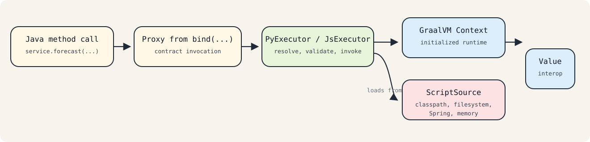

# Runtime

## Overview

The runtime layer provides the adapter API on top of GraalVM Polyglot for Python and experimental
JavaScript execution.

Its core purpose is simple: bind a Java interface to a guest-language implementation and call it as normal Java code.

> Note
> The runtime adapter is intended for trusted application embedding. It is not a sandboxing framework.

## Core Runtime Module

`runtime/polyglot-adapter` is framework-neutral and contains the execution model used by every integration style.

### Main Components

- `AbstractPolyglotExecutor`: shared proxy binding, source caching, metadata, and common invocation helpers
- `PyExecutor`: Python-specific script loading, export resolution, instance caching, and binding validation
- `JsExecutor`: experimental JavaScript-specific script loading, function lookup, and binding validation
- `PolyglotHelper`: language-specific `Context` creation and initialization
- `ScriptSource` implementations: classpath, filesystem, in-memory, and composite resolution

## How Runtime Execution Works



### Context Creation

`PolyglotHelper` creates a language-specific `Context.Builder`, applies an optional customizer, builds the context, and calls `context.initialize(languageId)`.

Current defaults:

- `allowAllAccess(true)`
- `allowExperimentalOptions(true)`
- interpreter-only warnings disabled
- Python experimental feature warnings disabled

For Python, context creation uses `GraalPyResources.contextBuilder(...)` with a virtual file system. For JavaScript, it uses the regular `Context.newBuilder(...)`.

> **Security warning:** `allowAllAccess(true)` grants guest code unrestricted access to host Java
> types, I/O, and environment variables. These defaults are intended solely for **trusted scripts**
> that are part of the application. Do not use the adapter to execute untrusted or
> user-supplied scripts. See
> [`runtime-semantics.md`](runtime-semantics.md#security-contract) for the full security contract.

### Prepared GraalPy Runtime Resources

GraalVM 25.0.4.1.1 supports preparing runtime resources before application launch with
[`Engine.copyResources`](https://docs.oracle.com/en/graalvm/jdk/25/sdk/org/graalvm/polyglot/Engine.html).
Run this in a separate build or installation JVM with the same GraalPy dependencies as the
application (`Engine` is from `org.graalvm.polyglot`, `Path` from `java.nio.file`; the call can
throw `IOException`):

```java
if (!Engine.copyResources(Path.of("graalpy-resources"), "python")) {
    throw new IllegalStateException("No Python runtime resources were copied");
}
```

Deploy the generated directory with the application, then select it at JVM launch:

```bash
java --enable-native-access=ALL-UNNAMED \
  -Dpolyglot.engine.resourcePath=./graalpy-resources -jar application.jar
```

The same command works for Spring Boot applications using this starter. Set this JVM system
property before the first Engine is initialized; it is process-wide. No new starter property or
Context customizer is needed. A relative path resolves against the process working directory.

The generated layout contains the Python standard library and required native/runtime resources.
Include any additional GraalVM languages/tools used by the application in preparation as well.
Application VFS `src` and `venv` resources remain separately configured by `GraalPyResources`.
Preparing runtime files avoids their first-use unpacking; Python initialization, application
imports and binding validation still execute normally. An existing default resource cache already
reuses extracted files, so measure process-to-first-response latency before adopting this setup.

Use a complete bundle built for the same artifact versions, OS and architecture. Regenerate it
when those change. Prepare a separate immutable bundle and deploy it atomically: `copyResources`
replaces component directories and must not target a live application's bundle. The deployed
directory can be read-only; missing or damaged files can cause native-library or Python import
errors. Context shutdown leaves the prepared directory intact. This setup preserves the starter's
fail-fast configuration and Context/Engine ownership.

### Opt-In Shared Python Engine

The existing APIs support a caller-owned `org.graalvm.polyglot.Engine`; no new factory or global
singleton is required. Each Context still initializes Python and keeps its own guest globals.
An Engine can share code caches across Contexts; it does not share Python objects or the adapter's
per-executor caches.

```java
try (Engine engine = Engine.newBuilder("python")
        .option("engine.WarnInterpreterOnly", "false").build()) {
    try (Context context = PolyglotHelper.newContext(
            SupportedLanguage.PYTHON, false,
            builder -> builder.engine(engine)
                .allowAllAccess(true)
                .allowExperimentalOptions(true)
                .option("python.WarnExperimentalFeatures", "false"));
         PyExecutor executor = PyExecutor.createWithContext(
            context, scriptSource, ContextOwnership.OWNED_BY_EXECUTOR)) {
        // Bind and call application contracts here; other Contexts can use the same Engine.
    }
    // Closing the executor/Context leaves the Engine available for another Context.
}
```

Imports are from `org.graalvm.polyglot` (`Engine`, `Context`),
`io.github.ih0rd.adapter.context` (`PolyglotHelper`, `PyExecutor`, `ContextOwnership`), and
`io.github.ih0rd.polyglot` (`SupportedLanguage`). `scriptSource` is the application's `ScriptSource`.

Pass `false` for recommended defaults and restore the access/Python options explicitly as above.
Otherwise the helper's `engine.WarnInterpreterOnly` option on `Context.Builder` conflicts with an
explicit Engine. Engine-level options belong on `Engine.Builder`. This opt-in configuration keeps
the same trusted-code access policy as the default helper; it does not add a sandbox.

The application owns the Engine and closes it **after all its Contexts and executors**. Sharing an
Engine differs from sharing a Context: each executor can own its separate Context. Use
`ContextOwnership.BORROWED` only when the caller also manages that Context. Executor serialization
is unchanged; this recipe makes no concurrent native-extension or shared-Context throughput claim.
All Contexts on one Engine must use the same host-access configuration and compatible
language options; GraalVM rejects conflicting configurations.

This is useful when repeatedly creating Contexts. It does not eliminate first Python initialization
or guarantee a faster single-Context Spring startup. The standalone
[JMH benchmark](https://github.com/ih0r-d/polyglot-platform/blob/main/benchmarks/README.md)
separates cold startup from repeated Context creation. Upstream documents
[Engine code sharing](https://www.graalvm.org/jdk25/reference-manual/embed-languages/#code-caching-across-multiple-contexts).

### Script Resolution

Executors never read the filesystem or classpath directly. They ask `ScriptSource` whether a logical script exists and open it through a `Reader`.

Logical names are derived from interface names:

- `StatsApi` -> `stats_api`
- `ForecastService` -> `forecast_service`

The actual physical path depends on the chosen `ScriptSource`.

Logical script names are not raw paths. Built-in `ScriptSource` implementations accept relative
`/`-separated names without the language extension, including nested names such as
`scripts/utils/helper`. They reject `null`, blank values, path traversal, absolute paths, Windows
drive or UNC paths, backslash separators, and resource prefixes such as `file:` or `classpath:`.
`FileSystemScriptSource` also rejects symbolic links that resolve outside the configured language
directory under the configured base directory.

### Binding and Invocation

`bind(Class<T>)` creates a JDK dynamic proxy. Each interface method becomes a guest-language method call with the same method name.

At invocation time:

- the proxy delegates to the executor
- the executor resolves or loads the guest script
- the guest function or object member is invoked through GraalVM `Value`
- the result is converted back through `Value.as(returnType)`

If the guest result is `null`, the proxy returns `null`.

If the Java method has a `void` return type, the guest function is called normally and the result
is discarded without any type conversion.

Failures during guest execution surface as adapter exceptions (`InvocationException`,
`BindingException`, `ScriptNotFoundException`, `EvaluationException`). `PolyglotException` thrown
by guest code during proxy method invocation is wrapped as `InvocationException` with the original
`PolyglotException` as the cause. All are unchecked. See
[`runtime-semantics.md`](runtime-semantics.md#exception-contract) for the full exception contract.
For symptom-oriented fixes, see [`troubleshooting.md`](troubleshooting.md).

### Array, Collection and Buffer Transfers

Arguments are passed through the existing Polyglot API; the adapter does not serialize them or
pre-copy Java arrays/collections into Python-owned containers. Creating `list(values)` in Python
materializes a separate Python list. Returning the original Java array can preserve its identity;
returning a Python list as `int[]` instead eagerly converts and copies its elements into a Java
array. Those are different contracts, so an automatic snapshot or array-reuse shortcut is unsafe.

Result conversion remains `Value.as(method.getReturnType())`, including configured custom target
mappings. A Java `List` return type normally exposes a guest-backed view, not an eagerly detached
array; its operations require an open Context. The binding uses the raw return class, not generic
component information. Choosing a view can avoid eager materialization when that lifetime and
mutation behavior suits the application's existing contract, but is not a drop-in array replacement.
See upstream [Value conversion rules](https://docs.oracle.com/en/graalvm/jdk/25/sdk/org/graalvm/polyglot/Value.html#as(java.lang.Class)).

On the verified GraalPy **25.0.4.1.1** JVM setup, Java heap/direct `ByteBuffer` objects expose
buffer elements to the Java Polyglot API, but Python `memoryview(buffer)`, `len(buffer)` and
`list(buffer)` reject them. Java methods such as absolute `get(index)` remain callable from Python
with the configured host access. Per-byte host calls are not a bulk buffer transfer; preserve the
buffer's position/limit, read-only status and signed Java byte semantics when using that route.
Python `bytes` results can be copied into Java `byte[]` through the existing result conversion.
No automatic zero-copy buffer interoperability is promised. Newer upstream
[25.1 release notes](https://www.graalvm.org/release-notes/25.1/) describe foreign-buffer Python
protocol support; that is not evidence of support on this pinned LTS version or a reason to upgrade
within a data-transfer optimization task.

The standalone data-transfer benchmarks separate argument passing, Python materialization,
Python-only computation and Java result conversion. See
[benchmark instructions](https://github.com/ih0r-d/polyglot-platform/blob/main/benchmarks/README.md).

## Python Runtime Details

`PyExecutor` is convention-driven.

### Expected Layout

- Java interface: `ForecastService`
- script: `forecast_service.py`
- export name: `ForecastService`

### Supported Export Styles

Class-style export:

```python
polyglot.export_value("ForecastService", ForecastService)
```

Dictionary-style export:

```python
polyglot.export_value(
    "ForecastService",
    {
        "forecast": forecast
    }
)
```

The executor:

- evaluates the script
- resolves the export from polyglot bindings first, then Python bindings
- instantiates callable exports
- reuses dictionary-style exports directly
- caches resolved targets per interface using weak references

`validateBinding(...)` resolves the instance eagerly, so it is useful at startup when applications want to fail early.

### Python Lifecycle And Cache Semantics

- Source cache is keyed by Java interface type.
- Instance cache is keyed by Java interface type and stored via weak references.
- `clearSourceCache()` clears only source entries; live Python instances remain reusable until instance cache is invalidated.
- `invalidateContractCache(iface)` evicts source + instance entries for that single contract.
- `reloadContract(iface)` is a focused helper: evict that contract cache and eagerly re-validate it.
- Script changes are not auto-detected. To pick up changed code, invalidate/reload the affected contract or recreate the executor.

The more explicit repository-level contract for these behaviors is documented in
[`runtime-semantics.md`](runtime-semantics.md).

## JavaScript Runtime Details

`JsExecutor` uses the same script naming convention but a different binding model.

Expected layout:

- Java interface: `ForecastService`
- script: `forecast_service.js`
- functions in JS bindings: `forecast(...)`

When a Java interface is validated or called:

- the script is evaluated once and cached by interface
- each interface method must exist as an executable JavaScript function
- method calls are executed from language bindings

The runtime does not currently define a separate JavaScript export object convention comparable to Python's class-style and dictionary-style exports.

JavaScript support is intentionally narrower than Python in this release line and is currently
treated as experimental runtime-only binding support, not parity with Python lifecycle semantics.

## Adapter API Surface

Applications normally interact with the runtime through:

- `PyExecutor.create(...)` or `PyExecutor.createWithContext(...)`
- `JsExecutor.create(...)` or `JsExecutor.createWithContext(...)` for the experimental JavaScript path
- `bind(...)`
- `bind(..., convention)`
- `validateBinding(...)`
- `validateBinding(..., convention)`
- `metadata()`

`metadata()` returns a lightweight snapshot intended for diagnostics, actuator info, or metrics. It is not a stable serialization format.

### Context Ownership

Executor factories that create their own GraalVM `Context`, such as `PyExecutor.create(...)`, own
that context and close it from `executor.close()`.

The legacy `createWithContext(context, scriptSource)` overloads and public constructors keep their
historical behavior: the executor closes the supplied context. This is source-compatible with
existing applications that rely on executor-managed lifecycle.

For shared or externally managed contexts, use the overload that accepts `ContextOwnership`:

```java
Context sharedContext = Context.newBuilder("python").allowAllAccess(true).build();
PyExecutor executor =
    PyExecutor.createWithContext(
        sharedContext, scriptSource, ContextOwnership.BORROWED);
```

With `ContextOwnership.BORROWED`, `executor.close()` releases executor-local caches and marks the
executor closed, but it does not close the supplied context. The caller remains responsible for
closing the context after all borrowers are done.

Executor access to a context is serialized per executor instance. If multiple executors share one
borrowed context, callers must still coordinate access across those executors according to GraalVM's
context lifecycle and threading constraints.

## Binding Conventions

The runtime currently exposes three convention values:

- `DEFAULT`
- `BY_INTERFACE_EXPORT`
- `BY_METHOD_NAME`

Current behavior:

- Python:
  - `DEFAULT`: backward-compatible export-based binding
  - `BY_INTERFACE_EXPORT`: explicit export-object/class convention
  - `BY_METHOD_NAME`: direct function lookup from bindings by Java method name
- JavaScript:
  - `DEFAULT`: function lookup by method name
  - `BY_METHOD_NAME`: same runtime path as `DEFAULT`
  - `BY_INTERFACE_EXPORT`: rejected explicitly

Important compatibility note:

- Python invocation behavior under `DEFAULT` remains aligned with the historical export-based path.
- Python validation under `DEFAULT` is now stricter: if the exported contract exists but required Java methods are missing or not executable, `validateBinding(...)` fails earlier than before.

For Python `BY_METHOD_NAME`, a module source is evaluated after its first successful validation or
invocation for that contract and executor, then reused. Mutable Python globals persist between its
method calls. A failed module evaluation is retried. `clearSourceCache()` allows all method-name
contract modules to be evaluated again; `invalidateContractCache(iface)` or
`reloadContract(iface, Convention.BY_METHOD_NAME)` resets one contract's loaded marker. These
operations do not roll back globals already present in the Python Context. Earlier versions
re-evaluated the module on every bound call, so applications relying on repeated module-level side
effects must move them into the function or explicitly invalidate/reload. This behavior does not
change Python `DEFAULT` binding. `preloadScript()` remains separate and may evaluate the same source
again when the contract is later validated or invoked.

## Spring Boot Starter

`runtime/polyglot-spring-boot-starter` wraps the runtime adapter for Spring applications.

### What It Provides

- `PolyglotAutoConfiguration`
- `PolyglotPythonAutoConfiguration`
- `PolyglotJsAutoConfiguration`
- `SpringPolyglotContextFactory`
- `PolyglotExecutors`
- `@EnablePolyglotClients`
- `PolyglotClientRegistrar`
- `PolyglotClientFactoryBean`
- actuator contributors
- Micrometer meter binder
- startup warmup lifecycle

### How Users Interact With the Runtime Adapter in Spring

1. Add the starter and language runtime dependencies.
2. Enable the desired languages under `polyglot.*`.
3. Annotate interfaces with `@PolyglotClient`.
4. Enable scanning with `@EnablePolyglotClients`.
5. Inject the generated Spring beans as normal interfaces.

If `@EnablePolyglotClients` does not declare `basePackages`, the starter scans the package of the
importing configuration class.

Language resolution rules for `@PolyglotClient` are enforced by `PolyglotClientFactoryBean`:

- one explicit language: use that executor
- multiple explicit languages: fail
- no explicit language and exactly one executor available: use it
- no explicit language and multiple executors available: fail and require explicit configuration

## Spring Configuration

Current configuration properties live under `polyglot.*`.

Core properties:

- `polyglot.core.enabled`
- `polyglot.core.fail-fast`
- `polyglot.core.log-metadata-on-startup`
- `polyglot.core.log-level`

Python properties:

- `polyglot.python.enabled`
- `polyglot.python.resources-path`
- `polyglot.python.safe-defaults`
- `polyglot.python.warmup-on-startup`
- `polyglot.python.preload-scripts`

JavaScript properties:

- `polyglot.js.enabled`
- `polyglot.js.resources-path`
- `polyglot.js.warmup-on-startup`
- `polyglot.js.preload-scripts`

Operational properties:

- `polyglot.metrics.enabled`
- `polyglot.actuator.enabled`
- `polyglot.actuator.info.enabled`
- `polyglot.actuator.health.enabled`

Starter behavior:

- `polyglot.core.fail-fast=true` eagerly instantiates discovered `@PolyglotClient` beans during
  startup so invalid bindings fail before the application begins serving requests. Binding checks
  resolve the script and export without calling bound business methods; evaluating the Python module
  and constructing an exported class can still execute initialization code.
- The default is `true`. Setting `polyglot.core.fail-fast=false` defers validation of otherwise
  unrequested clients, although injecting a client into an eager singleton can still validate it
  during startup. This does not disable context creation, warmup, or configured preload scripts.
- This runtime validation is distinct from the opt-in Maven `polyglot:validate-contracts` goal. The
  Maven goal statically checks a supported Java/Python source subset without creating a GraalVM
  context or executing Python; see [Code Generation](codegen.md#opt-in-java-to-python-contract-validation).
- `polyglot.core.log-metadata-on-startup=true` emits a single startup summary at the configured
  `polyglot.core.log-level`.
- `polyglot.python.preload-scripts` and `polyglot.js.preload-scripts` evaluate the listed logical
  scripts during startup after warmup. These names are resolved through the configured
  `ScriptSource`; they are not interface names, they do not populate interface caches, and repeated
  evaluation or repeated script side effects remain possible on later contract binding.
- `polyglot.python.safe-defaults=true` applies the starter's recommended GraalPy defaults. When
  disabled, the starter creates a more minimal Python context and expects applications to provide
  their own `PolyglotContextCustomizer` beans if they need additional options.

### Shared Engine in Spring Boot

Configure Python and provide the existing customizer SPI. Restore the access/Python defaults
explicitly:

```properties
polyglot.python.enabled=true
polyglot.python.safe-defaults=false
polyglot.python.resources-path=classpath:python
```

The configuration below
declares an executor bean with an explicit Engine dependency so Spring closes that executor
before the Engine. The starter backs off for this bean and keeps its normal client, warmup,
preload and fail-fast integration. This uses supported helper/executor/customizer APIs rather
than depending on Spring wiring implementation classes; no new starter property or Engine
auto-detection is involved.

```java
@Configuration(proxyBeanMethods = false)
class SharedPythonEngineConfig {
    @Bean(destroyMethod = "close")
    Engine pythonEngine() {
        return Engine.newBuilder("python")
            .option("engine.WarnInterpreterOnly", "false").build();
    }

    @Bean
    PolyglotContextCustomizer sharedPythonEngine(Engine pythonEngine) {
        return (language, builder) -> {
            if (language == SupportedLanguage.PYTHON) {
                builder.engine(pythonEngine)
                    .allowAllAccess(true)
                    .allowExperimentalOptions(true)
                    .option("python.WarnExperimentalFeatures", "false");
            }
        };
    }

    @Bean(destroyMethod = "close")
    @DependsOn("pythonEngine")
    PyExecutor pyExecutor(
            @Qualifier("pyScriptSource") ScriptSource scriptSource,
            ObjectProvider<PolyglotContextCustomizer> customizers) {
        Context context = PolyglotHelper.newContext(SupportedLanguage.PYTHON, false,
            builder -> customizers.orderedStream()
                .forEach(c -> c.customize(SupportedLanguage.PYTHON, builder)));
        return PyExecutor.createWithContext(
            context, scriptSource, ContextOwnership.OWNED_BY_EXECUTOR);
    }
}
```

Use Spring's `org.springframework.context.annotation` annotations and
`org.springframework.beans.factory.ObjectProvider`, plus
`org.springframework.beans.factory.annotation.Qualifier`. The SPI type is
`io.github.ih0rd.polyglot.annotations.spring.context.PolyglotContextCustomizer`;
`ScriptSource` is `io.github.ih0rd.polyglot.model.config.ScriptSource`. Runtime imports are the
same as in the core recipe above.

For an Engine shared across separate Spring applications, its external owner must keep it alive
until **all** those applications close. Register only customizers referencing that Engine; do not
let an individual application's shutdown close it. Any additional Context created manually
remains the caller's responsibility and must close before its Engine. Default starter
configuration continues to create independent Engines and use the existing lifecycle.

## Operational Behavior

If actuator is present, the starter can expose:

- a health indicator that reports whether at least one executor is available
- an info contributor with configuration and executor availability

If Micrometer is present, the starter registers gauges for:

- executor enablement
- source cache size
- Python instance cache size
- count of Python bound interfaces
- count of JavaScript loaded interfaces

## Current Runtime Limits

- The runtime is intended for trusted application embedding, not untrusted sandbox execution.
- JavaScript execution is supported as an experimental bounded path, but JavaScript contract
  generation is not.
- Startup preloading evaluates named scripts but does not provide hot reload or source versioning.
- Startup preloading is raw script evaluation, not true contract prebinding.
- The binding convention is currently opinionated and name-based; alternative conventions are not implemented yet.
- Starter-managed executors are shared singleton beans that serialize access to the underlying
  GraalVM `Context`. They are intended for concurrent Spring application use, but contract loading
  and cache invalidation remain per-executor concerns.
- Source caching is keyed by Java interface. Python target instances are cached per interface using
  weak references. Changing a script after startup does not trigger automatic reload; clear caches
  or recreate the executor if you need to pick up changed sources.
